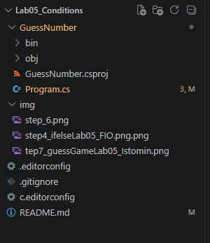
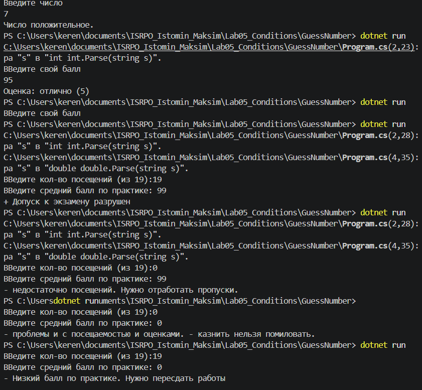
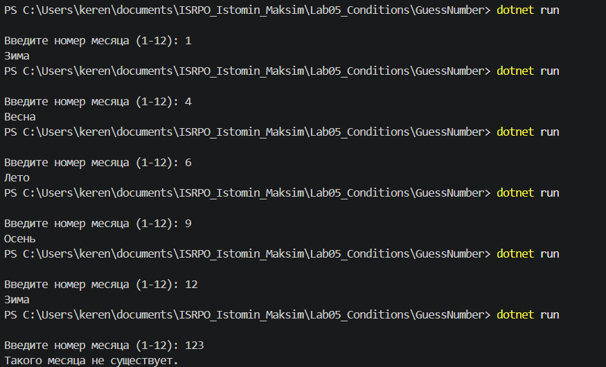
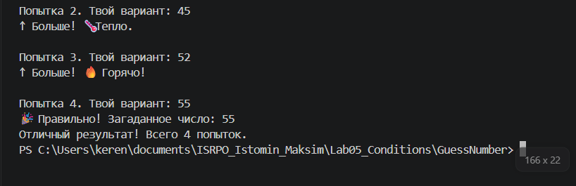

# Лабораторная работа №5

**Истомин Максим**
**Группа - ИСП-243**
**Дата: 10.11.2026**

## Что изучено
- ветвление с помощью `if/else` и `else if`;
- логические операторы `&&`, `||`, `!`;
- тернарный оператор `?:` и множественный выбор `switch/case`;
- безопасный ввод чисел через `int.TryParse()` и `Random`.

## Структура проекта



## Пример кода
```csharp
string GetHint(int difference) {
    switch (difference) {
        case <= 3:
            return "🔥 Горячо!";
        case <= 10:
            return "🌡 Тепло.";
        case <= 25:
            return "🌥 Прохладно.";
        default:
            return "❄ Холодно!";
    }
}
```

## Главные выводы:
1. Для простых условий из двух вариантов удобнее использовать тернарный оператор `?:`, а для сложных — `if/else`.
2. Конструкция `switch/case` читается лучше длинных цепочек `else if`, когда нужно проверить одну переменную на конкретные значения.
3. Метод `int.TryParse()` защищает программу от вылета при вводе текста вместо числа.

## Итоговая таблица

| Конструкция | Когда использовать |
| :--- | :--- |
| `if/else` | Общее ветвление, сложные условия |
| `else if` | Несколько взаимоисключающих вариантов |
| `switch/case` | Сравнение одной переменной с конкретными значениями |
| Тернарный оператор `?:` | Выбор одного из двух значений в одну строку |
| `&&` | Оба условия должны быть истинны |
| `\|\|` | Хотя бы одно условие должно быть истинно |
| `!` | Отрицание условия |
| `int.TryParse()` | Безопасное преобразование строки в число |
| `Random.Next(min, max)` | Генерация случайного числа в диапазоне |

## Ответы на вопросы
1. **Чем `int.TryParse()` безопаснее `int.Parse()`?**
   `int.TryParse()` не вызывает ошибку при некорректном вводе, а возвращает `false`. Его используют при вводе от пользователя, а `int.Parse()` — когда строка содержит число.

2. **Когда `switch` удобнее, чем цепочка `if/else if`?**
   Когда одна переменная сравнивается с набором фиксированных значений (например, выбор пункта от 1 до 4).

3. **Что произойдёт в `switch`, если убрать `break` после одного из `case`?**
   Если в `case` есть код, компилятор выдаст ошибку. Если `case` пустой, управление перейдёт к следующему `case`.

4. **Чем отличается `=` от `==` в C#?**
   `=` присваивает значение переменной, а `==` сравнивает два значения.

5. **Можно ли написать тернарный оператор внутри другого тернарного оператора?**
   Да, например: `string weather = temp >= 20 ? "тепло" : (temp > 0 ? "прохладно" : "мороз");`. Читаемость при этом ухудшается поэтому лучше использовать `if/else`.





